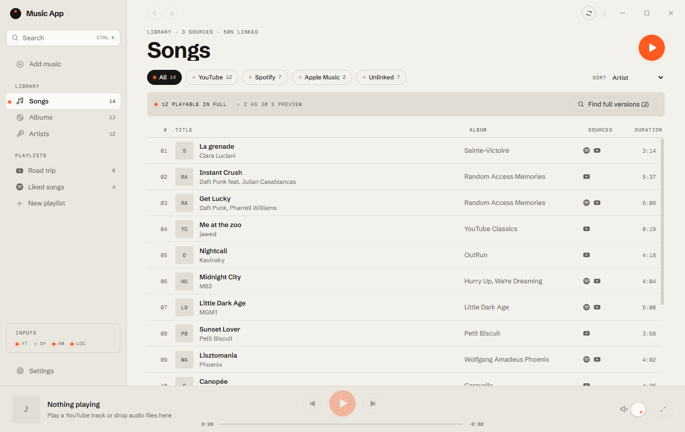

<div align="center">

# Music App

**One library for YouTube Music, Spotify, Apple Music and your own files.**

A fast, private desktop music player for Windows, built with Tauri 2 and Rust.




</div>

## Features

- **Unified library.** The same song on several services becomes one track (matched by ISRC, or title, artist and
  duration). Songs, Albums, Artists and Playlists views, YouTube-style sorting, drag and drop.
- **One search bar.** Your library as you type, YouTube's suggestions and your recent searches (kept on this PC), then
  one results page across your library, YouTube, YouTube Music and Apple Music.
- **Music only.** Talks, tutorials and gameplay that YouTube imports bring along are set aside in a fold you can open,
  in your library, playlists, mixes and search. One click says "it's music" (or not).
- **One player for every source.** Local files (native, gapless), YouTube (official embedded player), Apple Music
  previews and Spotify Connect share one queue, with crossfade, an immersive Now Playing screen, synced lyrics and a
  mini player in the sidebar (a spinning record with vinyl covers).
- **Playlists.** Import from YouTube Music and Spotify, create your own, export to YouTube Music, and share them by
  link, QR code or a 6-digit code on your local network.
- **Mixes made on your PC.** Daily Mixes, a time-of-day mix and Rediscover, built from your own listening history.
  A Home page you arrange by dragging its sections.
- **Windows integration.** Media keys, the Windows media panel, tray icon, keyboard shortcuts, system light/dark mode
  and accent color.
- **Live Editor.** Change the playing song as it plays: slowed, sped up, pitch, bass and EQ, reverb, echo, 3D / 8D
  sound. Save versions per song; export a modified copy of your own files.
- **Sync Mode.** Your playlists, history, Live Editor versions and settings on all your PCs, through OneDrive (or
  any shared folder) or straight over your network with a 6-digit code.
- **Your language.** English and French, following Windows or picked in Settings.
- **Customization.** Themes that change everything: colors (or a whole palette from one color), a background
  picture, corners, font, the look of lists and the player, even your own CSS; shared as `.theme` files.
- **Add-ons and plugins.** Optional extras, off by default (first: Discord Rich Presence). Plugins made by others
  install from a folder after you approve what they may do, and run sealed off from the app
  ([writing one](docs/plugins.md)).
- **Ad and tracker blocking**, built in.

## Privacy and playback

- **No server, no account of ours.** Your library is a local SQLite database; tokens stay in the Windows Credential
  Manager.
- **Sync Mode (off until you set it up).** Each PC writes one file in a folder you pick (OneDrive by default): your
  library, history and settings, sealed with your password if you choose one (then your Spotify app ID and Music
  Detector token travel too); without a password, OneDrive can read them and you sign in again on each PC. Over your
  network, a 6-digit code seals the exchange. Details: [docs/sync-mode.md](docs/sync-mode.md).
- **Official playback only.** Music plays through each service's own player or from your files. Nothing is downloaded
  or extracted. Sound features (Adaptive Sound, the Live Editor) process what plays as it plays, in memory: nothing is
  recorded or saved (the Live Editor keeps its settings, never sound; only your own files can be exported), and
  Settings › Playback can keep YouTube's sound untouched.
- **One gateway to the network.** All requests go through the Rust core; the interface never calls the network itself.
- **Voice search (off until you allow it).** The mic uses Windows' own online speech recognition: while it listens,
  your voice goes to Microsoft's speech service through Windows. The app keeps nothing.
- **Lyrics.** Opening lyrics in Now Playing sends the song's title, artist, album and length to
  [LRCLIB](https://lrclib.net) (free, open lyrics database), then to YouTube Music when you're signed in. Answers are
  kept on your PC.
- **Music Detector (off until you allow it).** "Identify a song" listens for 10 seconds to the microphone, or to what
  this PC plays (asked separately; Music App pauses its own music meanwhile), keeps the sound in memory and sends it
  once to [AudD](https://audd.io) to name the song: a few a day with no account, more with your own AudD token. Nothing
  is saved; a token stays in the Windows Credential Manager.

## Getting started

Requirements: Windows 10 or 11 (WebView2), [Rust](https://rustup.rs) stable, Node.js 22 or later and
[pnpm](https://pnpm.io).

```bash
pnpm install
```

```bash
pnpm dev
```

Then connect your services in **Settings › Accounts**:

| Service | How it connects |
|---|---|
| YouTube Music | Sign in with Google, on Google's own page. Several accounts supported. |
| Spotify | Your own app from the Spotify Developer Dashboard (Premium needed in development mode), or paste public playlist links. |
| Apple Music | Catalog search and 30-second previews, no account needed. |
| Local files | Add your music folders. |

## Development

| Command | Description |
|---|---|
| `pnpm dev` | Run the app with hot reload |
| `pnpm check` | Type check, lint, tests (Vitest and cargo) and Clippy. Must pass before every commit |
| `pnpm build` | Build the Windows installer (needs cargo-about for its license notices, see [docs/licenses.md](docs/licenses.md)) |

```
crates/core         Library model, track matching, SQLite, sync, mixes, sharing
crates/connectors   YouTube Music, Spotify, Apple Music catalog, Discord, nearby sharing
crates/player       Native audio engine (rodio, symphonia) with a gapless queue
crates/shield       Ad and tracker blocker
src-tauri           Desktop shell: IPC commands, keychain, Windows integration
ui                  React 19 interface (Zustand, Tailwind CSS 4), organized by feature
```

More in [docs/](docs/README.md) and [CONTRIBUTING.md](CONTRIBUTING.md).

## License

Source-available, not open source. You may use the app for free. Issues and pull requests are welcome; changing the
code for any other purpose, or reusing any part of it in another project, requires the author's written permission.
See [LICENSE](LICENSE).

Spotify, YouTube, Apple Music and Discord are trademarks of their respective owners. Service logos come from
[Simple Icons](https://simpleicons.org) (CC0).
