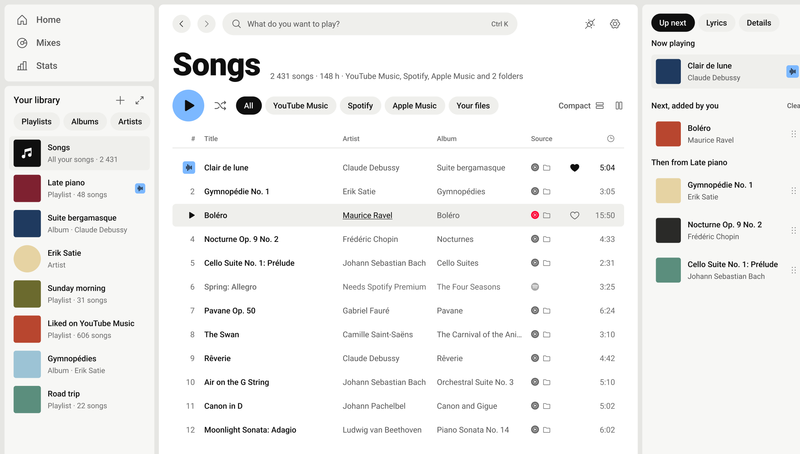

<div align="center">

# Legato

**One library and one player for YouTube Music, Spotify, Apple Music and your own files.**

Windows 10 and 11 · free · no account of ours

[Website](https://clovis500c.github.io/legato/) · [Download](https://github.com/Clovis500c/legato/releases/latest) · [What leaves your PC](https://clovis500c.github.io/legato/#privacy)

<picture>
  <source media="(prefers-color-scheme: dark)" srcset="site/assets/app-dark.png">
  
</picture>

</div>

What it does, how each service plays, what leaves your PC and the FAQ: on the
[website](https://clovis500c.github.io/legato/) (its source is `site/`).

## Build from source

Windows 10 or 11, [Rust](https://rustup.rs) stable, Node.js 22 or later and [pnpm](https://pnpm.io).

```bash
pnpm install
pnpm dev
```

`pnpm check` must pass before every commit; `pnpm build` makes the installer. More in [CONTRIBUTING.md](CONTRIBUTING.md)
and [docs/](docs/README.md).

## License

Source-available, not open source. You may use the app for free. Issues and pull requests are welcome; changing the
code for any other purpose, or reusing any part of it in another project, requires the author's written permission.
See [LICENSE](LICENSE).

Spotify, YouTube and Apple Music are trademarks of their respective owners. Service logos come from
[Simple Icons](https://simpleicons.org) (CC0).
