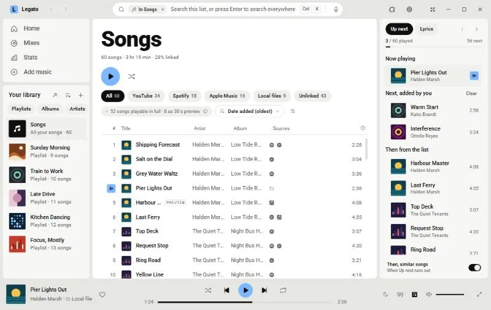
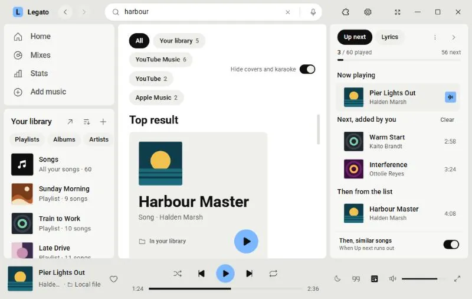
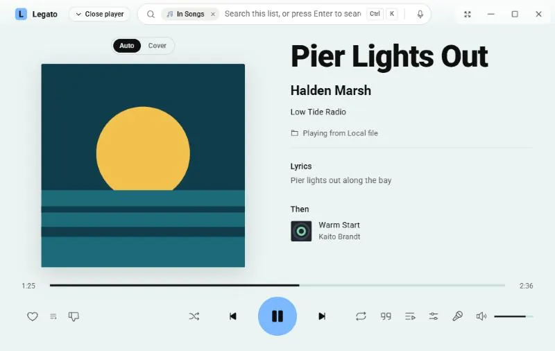
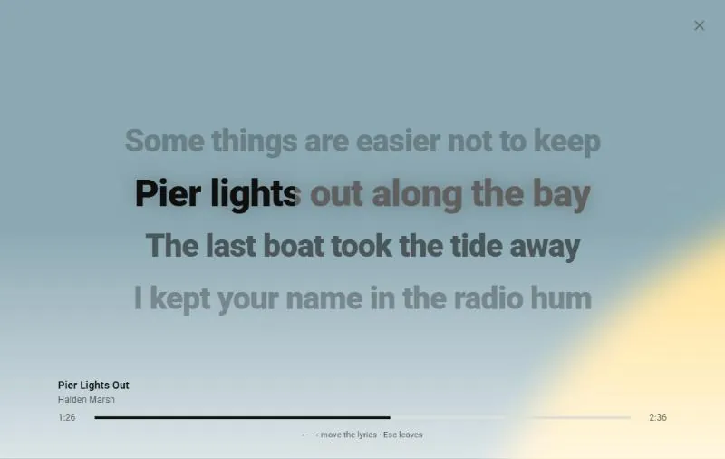

<div align="center">

# Legato

**One library and one player for YouTube Music, Spotify, Apple Music and your own files.**

Windows 10 and 11 · free · no account of ours

[](https://github.com/Clovis500c/legato/releases/latest)
[](https://github.com/Clovis500c/legato/actions/workflows/check.yml)
[](LICENSE)

[Website](https://clovis500c.github.io/legato/) · [Download](https://github.com/Clovis500c/legato/releases/latest) · [What leaves your PC](https://clovis500c.github.io/legato/#privacy)

<picture>
  <source media="(prefers-color-scheme: dark)" srcset="site/public/shots/library-dark.webp">
  
</picture>

</div>

## Get it for free

1. Open the [latest release](https://github.com/Clovis500c/legato/releases/latest).
2. Download `Legato_…_x64-setup.exe` and run it (the `.msi` is the same app, for managed PCs).
3. Open Legato, then Settings › Accounts: connect YouTube Music, Spotify, Apple Music and your music folders.

New versions install themselves between two songs; Settings › General › Updates picks Stable or Beta.

The installer isn't signed with a Windows code-signing certificate, so SmartScreen may warn the first time: **More info ›
Run anyway**. Updates are signed and checked by the app before it installs them. An early Android version
(`…_android-arm64.apk`) is attached to the releases too.

## What you get

- **One library**: YouTube Music, Spotify, Apple Music, SoundCloud and Deezer links, playlist files, and your own files,
  in one list, with search across all of them.
- **Official playback only**: YouTube's own player, Spotify Connect, your files in the app's own gapless player.
  Nothing is downloaded, recorded or extracted from a service.
- **Playlists, mixes and radios**, an Auto-DJ, timed lyrics and a full-screen karaoke, a Live Editor and a visualizer.
- **Sync Mode**: your library on all your PCs through a OneDrive folder or your network, no server.
- **Light on the PC**, with themes, 18 languages, a tray mode, picture-in-picture and a phone remote.

<p align="center">
  <picture>
    <source media="(prefers-color-scheme: dark)" srcset="site/public/shots/search-dark.webp">
    
  </picture>
  <picture>
    <source media="(prefers-color-scheme: dark)" srcset="site/public/shots/player-dark.webp">
    
  </picture>
  <picture>
    <source media="(prefers-color-scheme: dark)" srcset="site/public/shots/karaoke-dark.webp">
    
  </picture>
</p>

What it does in full, how each service plays, what leaves your PC and the FAQ: on the
[website](https://clovis500c.github.io/legato/) (its source is `site/`).

Why Legato: it plays through the official players and never downloads, records or extracts a platform's audio; it holds 149 MB of RAM paused and 57 MB in the
tray (measured 2026-11-05, Windows 11, 10 000 songs, [all the numbers](docs/performance.md)); Sync Mode keeps your PCs
in step with no server; your plays go to Last.fm if you connect it.

## Build from source

Windows 10 or 11, [Rust](https://rustup.rs) stable, Node.js 22 or later and [pnpm](https://pnpm.io).

```bash
pnpm install
pnpm dev
```

`pnpm check` must pass before every commit; `pnpm build` makes the installer. More in [CONTRIBUTING.md](CONTRIBUTING.md)
and [docs/](docs/README.md).

## License

Source-available, not open source. You may use the app for free. Issues and pull requests are welcome; changing the
code for any other purpose, or reusing any part of it in another project, requires the author's written permission.
See [LICENSE](LICENSE).

Spotify, YouTube and Apple Music are trademarks of their respective owners. Service logos come from
[Simple Icons](https://simpleicons.org) (CC0).
