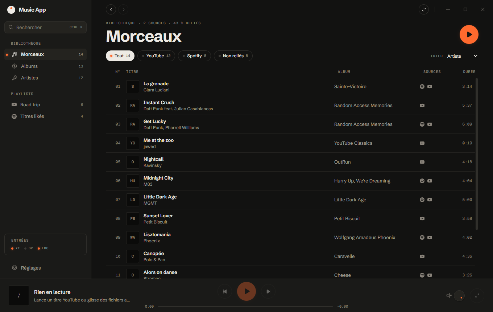
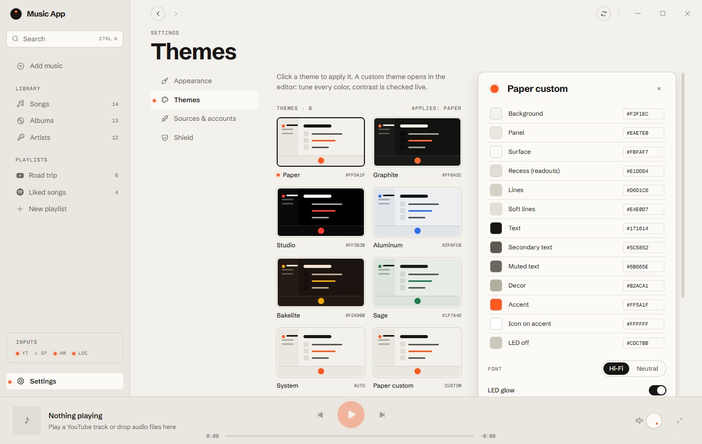
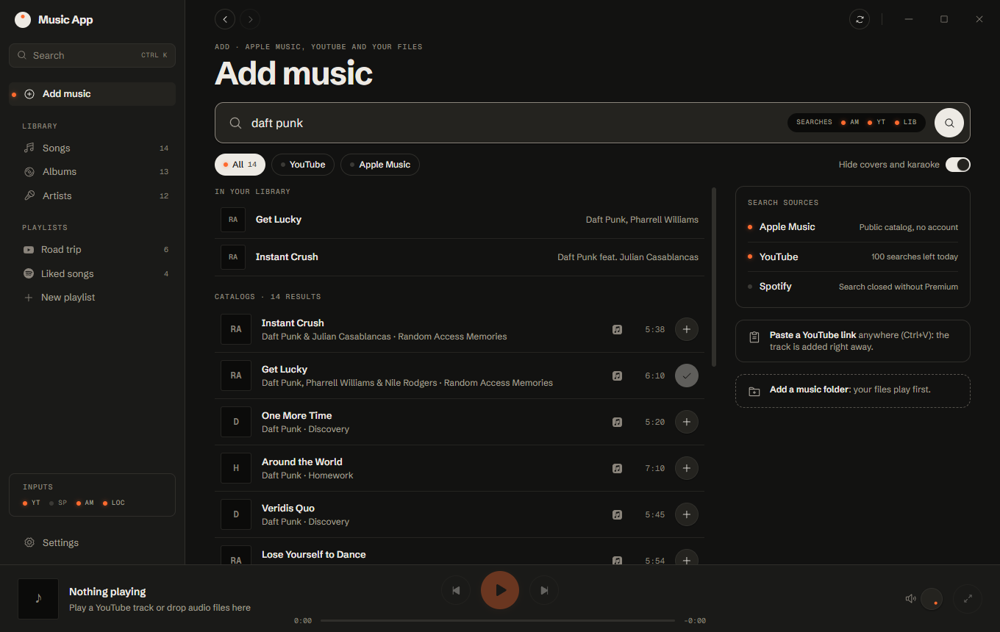

# Music App

**All your music in one place: YouTube, Spotify, Apple Music and your local files, in a single library.**
A fast, lightweight desktop app (Tauri 2 + Rust), serverless: your data stays on your computer.


## Features

- **Unified library**:
  - the same track on several services is recognized and merged (by ISRC, or by title, artist and duration);
  - Songs, Albums, Artists and Playlists views;
  - real cover art everywhere (YouTube Music, YouTube, Apple Music, Spotify, covers embedded in local files);
  - instant search (Ctrl K).
- **Right-click menus everywhere**: tracks, playlists, albums, artists, mixes, search results and the player
  (play next, add to queue, play via, add to playlist, go to album or artist, copy link, copy video URL at the current time…).
- **Playback**:
  - one queue for every source: each track plays through its best source;
  - local files played natively and gapless (Rust engine, rodio/symphonia);
  - YouTube through the official embedded player;
  - Apple Music 30-second previews, with a link to the store;
  - "Play via" switches the current track to another of its sources;
  - "Find full versions" looks up a YouTube version for tracks that only preview;
  - one player design for every source: shuffle, repeat (queue or track), Now Playing tinted by the cover,
    mini player (the YouTube video always stays visible, with our controls below it).
- **Add music**:
  - search the Apple Music catalog (no account) and YouTube;
  - add a track by pasting a YouTube link (Ctrl+V);
  - scanned music folders (tags read with lofty).
- **Custom playlists**: create, rename, reorder, duplicate. A playlist imported from a service can be duplicated to edit it.
- **Your YouTube Music library**: sign in with Google (no keys), even several accounts or channels; their playlists and Liked Music come in. Spotify playlists with your own Spotify app key (Premium required in developer mode).
- **Export to YouTube Music**: any playlist becomes a private YouTube Music playlist; exporting again only adds what is missing.
- **Share playlists between Music Apps, serverless**:
  - compact code (about 9 bytes per track) as a `musicapp://` link or a QR code, read back from a screenshot;
  - nearby: a 6-digit code on the same network (mDNS discovery, SPAKE2 key exchange, encrypted transfer);
  - import shows what's already in your library and looks up the rest on YouTube and Apple Music.
- **Mixes, computed on your PC**: Daily Mixes from the artists you hear together, a time-of-day mix and Rediscover, built from your listening history and playlists. Steer them with "Less like this" and "Never in mixes"; nothing leaves your computer.
- **Customization**:
  - follows Windows by default: light or dark, and the Windows accent color, with a YouTube-style look (Roboto, YouTube's palettes);
  - 8 themes and a theme editor (13 colors, contrast checked live, export and import);
  - accent, font, cover shape, density, interface size, columns, covers in lists, one-click play, sidebar counts,
    start screen, animations, player options (readout, volume knob, tuner, cover tint, mini player).
- **Shield**: ad and tracker blocking with Brave's engine (adblock-rust, EasyList and EasyPrivacy lists).
- **Now Playing screen**: video or cover sized to the window, readout, tuner scale, input selector, volume knob, queue in play order.

| Graphite theme | Theme editor | Add music |
|---|---|---|
|  |  |  |

## Principles

- **Serverless**:
  - no backend: the library is a local SQLite database;
  - keys and tokens live in the Windows credential vault (`keyring` crate).
- **Sign in, no keys**: YouTube Music with your Google account, on Google's own page (like Pear Desktop); the app never sees your password. Spotify still needs your own app key (it has no keyless sign-in).
- **Official playback**:
  - official players, local files, Apple previews held in memory, Spotify Connect (remote control of your own Spotify app, Premium);
  - no audio extraction, nothing written to disk.
- **Original code**: everything is written from scratch.

## Getting started

Requirements:

- Windows 10 or 11 with WebView2;
- [Rust](https://rustup.rs) stable;
- Node.js 22 or later;
- [pnpm](https://pnpm.io).

```bash
pnpm install
```

```bash
pnpm dev
```

| Command | What it does |
|---|---|
| `pnpm dev` | Runs the app in development (Vite + Tauri) |
| `pnpm check` | Typecheck, lint, Vitest, clippy and `cargo test`. Must pass before every commit |
| `pnpm test` | Interface tests |
| `cargo test --workspace` | Rust tests |
| `pnpm build` | Windows installer |

### Connect your services

In the app, open **Settings › Accounts**:

- **YouTube Music**: "Sign in with Google". Add more Google accounts and pick which ones to sync. Uses YouTube Music's own web access (unofficial, may break if YouTube changes it).
- **Spotify**: an app on the Spotify Developer Dashboard (developer mode: the owner needs Premium, 5 users max).
  Preview: "Spotify web player" opens Spotify's own player in a window, signed in on Spotify's page, no keys (no import yet).
- **Local files**: add one or more music folders.

## Architecture

```
crates/
  core/        model, track matching, SQLite library, sync, local scan, share codes (MA1, QR), history and mixes
  connectors/  OAuth PKCE (loopback), YouTube, Spotify, iTunes catalog and previews, nearby share
  player/      local audio engine (dedicated thread, gapless queue, in-memory previews)
  shield/      ad blocker (adblock-rust) and YouTube player script
src-tauri/     Tauri shell: IPC commands, keychain, WebView2 hook
ui/            React 19 + Zustand + Tailwind v4, organized by feature
docs/          playback choices (playback.md), plan (plan-v2.md), UI review (ui-review.md)
```

Rules:

- all logic lives in `crates/`;
- `ui/src/shared/api.ts` is the only place that calls IPC;
- the interface never touches the network: everything goes through Rust;
- long lists are virtualized.

## Roadmap

Details in [docs/plan-v2.md](docs/plan-v2.md). Main steps:

- **Done**:
  - Hi-Fi redesign and themes;
  - ad shield;
  - custom playlists;
  - local folders;
  - catalog search;
  - smart playback (one queue for every source, previews, find versions);
  - playlist sharing (link, QR, nearby code);
  - personalized mixes;
  - YouTube export and Spotify Connect;
  - Windows theme and accent, cover art, one player for every source, right-click menus.
- **Next**:
  - polish (media keys, auto-updates).

## License

Source-available, not open source. You may use the app; copying or reusing the code or any part of the app needs the
author's written permission, and any permitted reuse must credit the author and link to this repository. See [LICENSE](LICENSE).
Spotify, YouTube and Apple Music are trademarks of their owners. Logos come from [Simple Icons](https://simpleicons.org) (CC0).
