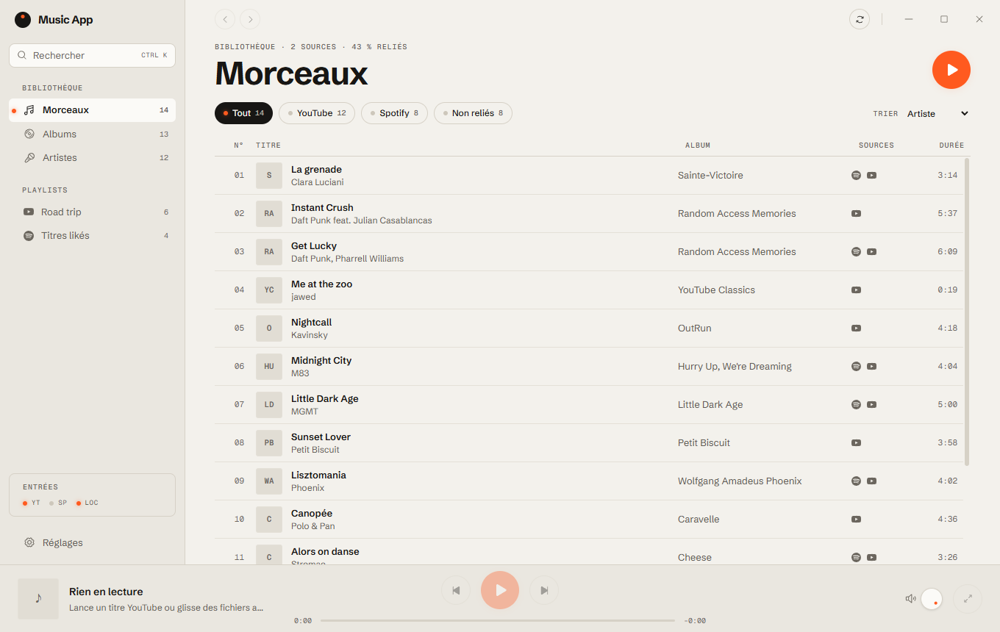
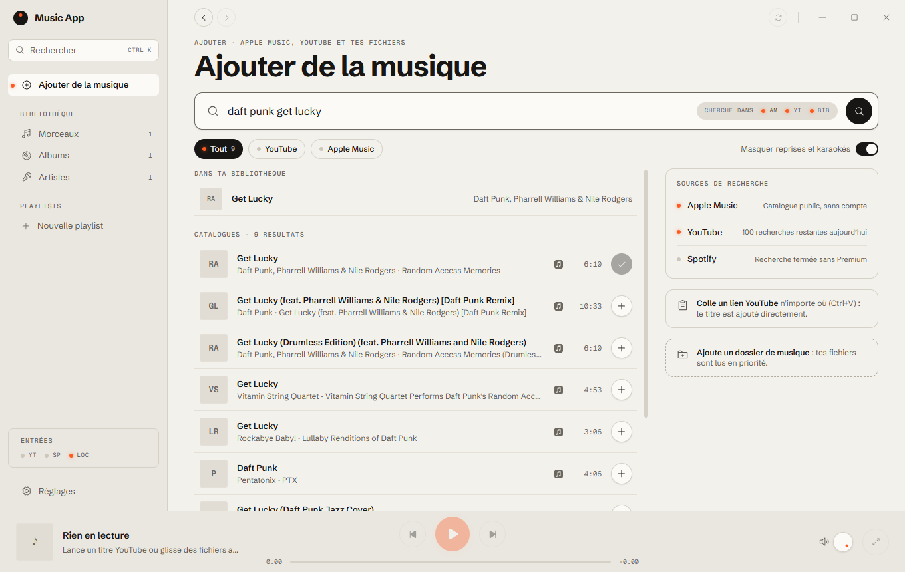

# Music App

**Toute ta musique au même endroit : YouTube, Spotify, Apple Music et tes fichiers locaux, dans une seule bibliothèque.**
Application de bureau rapide et légère (Tauri 2 + Rust), sans serveur : tes données restent sur ton ordinateur.



## Fonctionnalités

- **Bibliothèque unifiée** :
  - un même titre présent sur plusieurs services est reconnu et fusionné (par ISRC, ou par titre, artiste et durée) ;
  - vues Morceaux, Albums, Artistes et Playlists ;
  - recherche instantanée (Ctrl K).
- **Lecture** :
  - fichiers locaux en natif, sans blanc entre les titres (moteur Rust rodio/symphonia) ;
  - YouTube via le lecteur officiel intégré ;
  - le fichier local est toujours préféré quand il existe.
- **Ajouter de la musique** :
  - recherche dans le catalogue Apple Music (sans compte) et sur YouTube ;
  - ajout d'un titre en collant un lien YouTube (Ctrl+V) ;
  - dossiers de musique analysés (tags lus avec lofty).
- **Playlists perso** : créer, renommer, réordonner, dupliquer. Une playlist importée d'un service peut être dupliquée pour être modifiée.
- **Import** des playlists YouTube et Spotify avec ton propre compte (Spotify : Premium requis en mode développeur).
- **Personnalisation** :
  - 6 thèmes et un éditeur de thèmes (13 couleurs, contraste vérifié en direct, export et import) ;
  - accent, forme des pochettes, densité, taille de l'interface, colonnes, options du lecteur.
- **Bouclier** : blocage des pubs et des traqueurs avec le moteur de Brave (adblock-rust, listes EasyList et EasyPrivacy).
- **Écran En lecture** : afficheur, échelle graduée, sélecteur d'entrée, molette de volume, file d'attente.

| Thème Graphite | Éditeur de thèmes | Ajouter de la musique |
|---|---|---|
|  |  |  |

## Principes

- **Sans serveur** :
  - aucun backend : la bibliothèque est en SQLite locale ;
  - les clés et jetons sont dans le trousseau de Windows (crate `keyring`).
- **Tes propres clés** : chaque utilisateur branche ses propres identifiants Google et Spotify. L'app ne partage aucune clé.
- **Lecture officielle** :
  - lecteurs officiels, fichiers locaux, Spotify Connect (prévu) ;
  - aucune extraction d'audio.
- **Code original** : tout est écrit de zéro.

## Démarrer

Prérequis :

- Windows 10 ou 11 avec WebView2 ;
- [Rust](https://rustup.rs) stable ;
- Node.js 22 ou plus ;
- [pnpm](https://pnpm.io).

```bash
pnpm install
```

```bash
pnpm dev
```

| Commande | Rôle |
|---|---|
| `pnpm dev` | Lance l'app en développement (Vite + Tauri) |
| `pnpm check` | Typecheck, lint, tests Vitest, clippy et `cargo test`. Doit passer avant chaque commit |
| `pnpm test` | Tests de l'interface |
| `cargo test --workspace` | Tests Rust |
| `pnpm build` | Installeur Windows |

### Brancher tes services

Dans l'app, ouvre **Réglages › Sources et comptes** et suis l'assistant :

- **YouTube** : un projet Google Cloud avec un client OAuth « Application de bureau ». Il sert à l'import des playlists et à la recherche (100 recherches par jour).
- **Spotify** : une app sur le Spotify Developer Dashboard (mode développeur : le propriétaire doit être Premium, 5 utilisateurs au maximum).
- **Fichiers locaux** : ajoute un ou plusieurs dossiers de musique.

## Architecture

```
crates/
  core/        modèle, rapprochement des titres, bibliothèque SQLite, synchronisation, scan local
  connectors/  OAuth PKCE (port local), YouTube, Spotify, catalogue iTunes
  player/      moteur audio local (thread dédié, file sans blanc entre les titres)
  shield/      bloqueur de pubs (adblock-rust) et script du lecteur YouTube
src-tauri/     coque Tauri : commandes IPC, trousseau, accroche WebView2
ui/            React 19 + Zustand + Tailwind v4, organisé par fonctionnalité
docs/          choix de lecture (playback.md), plan (plan-v2.md), revue UI (ui-review.md)
```

Règles :

- toute la logique vit dans `crates/` ;
- `ui/src/shared/api.ts` est le seul point d'appel à l'IPC ;
- l'interface n'accède jamais au réseau : tout passe par Rust ;
- les listes longues sont virtualisées.

## Feuille de route

Le détail est dans [docs/plan-v2.md](docs/plan-v2.md). Les grandes étapes :

- **Fait** :
  - refonte Hi-Fi et thèmes ;
  - bouclier anti-pub ;
  - playlists perso ;
  - dossiers locaux ;
  - recherche dans les catalogues.
- **Suite** :
  - lecture intelligente (une seule file pour toutes les sources, aperçus) ;
  - comptes et export ;
  - partage de playlists entre utilisateurs (code ou QR) ;
  - mixes personnalisés ;
  - finitions (touches multimédia, mises à jour automatiques).

## Licence

Logiciel propriétaire, tous droits réservés. Voir [LICENSE](LICENSE).
Les marques Spotify, YouTube et Apple Music appartiennent à leurs propriétaires. Les logos viennent de [Simple Icons](https://simpleicons.org) (CC0).
